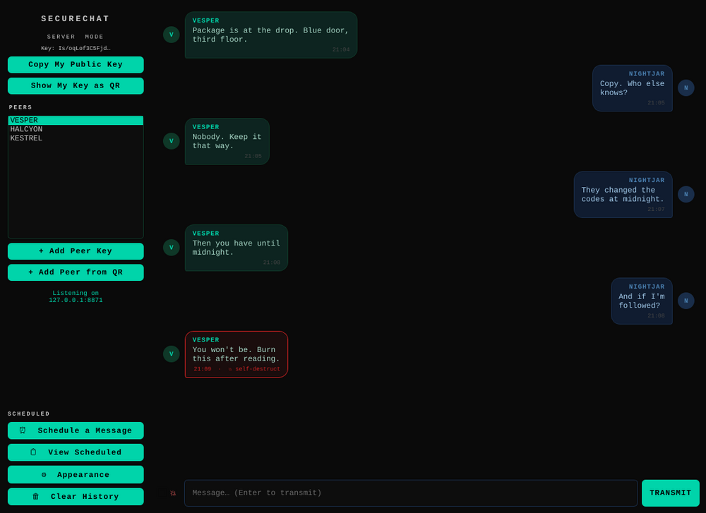
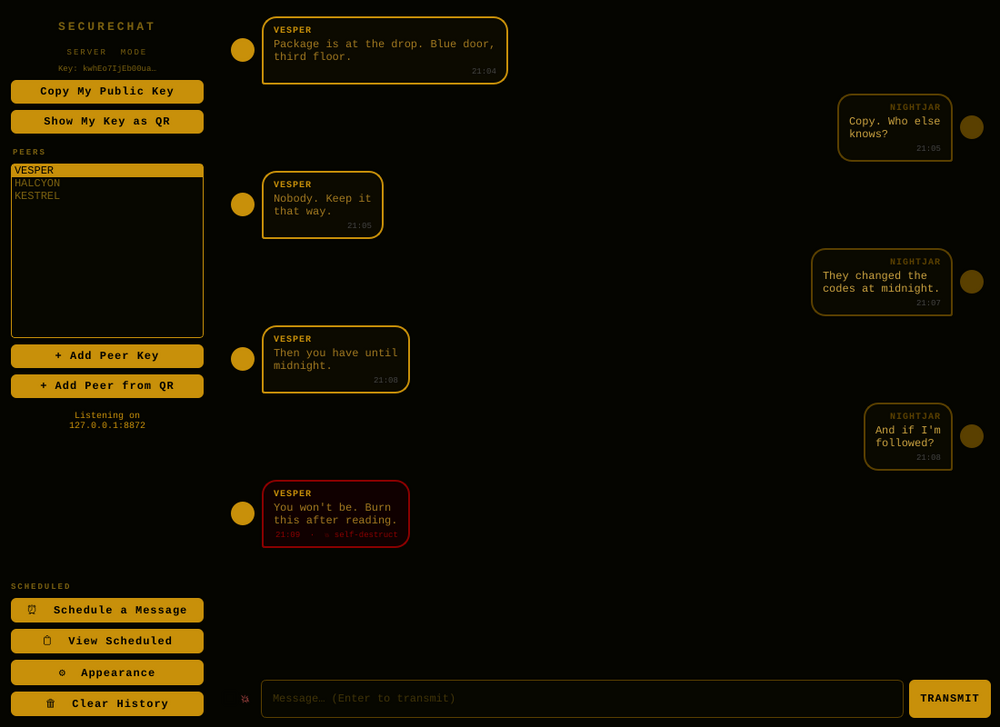
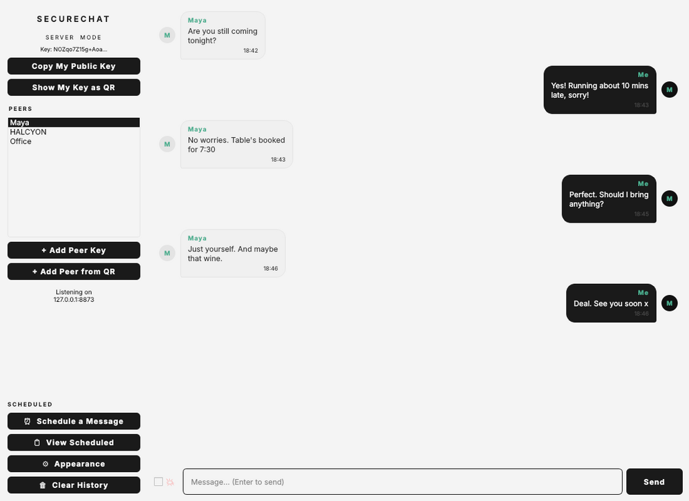
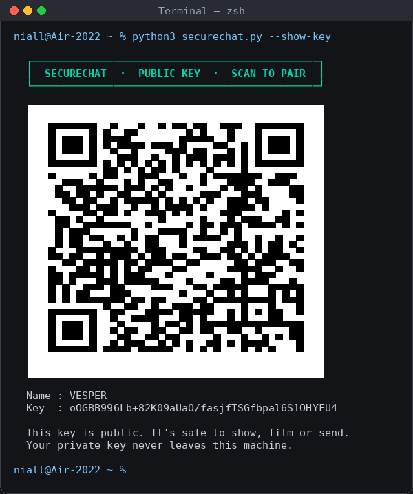
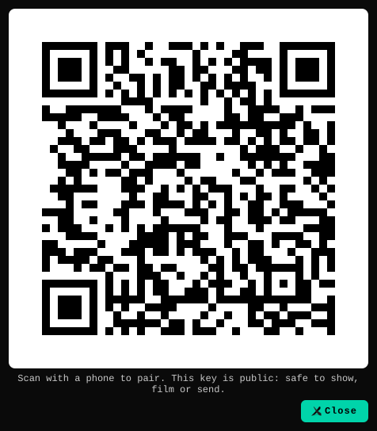

# 🔒 SecureChat — Free TV & Film Prop

A portable, peer-to-peer encrypted chat application designed for use as a **screen prop in TV and film productions**. Fully functional, fully customisable, completely free to use.

> Inspired by the aesthetic of *Mr. & Mrs. Smith* (2024, Prime Video — Donald Glover, Maya Erskine).

---

<p align="center"></p>

| Amber Terminal | Clean Light |
|---|---|
|  |  |

*Real screenshots of the running app. The red-bordered bubble is a self-destruct message. The conversations are fictional.*

---

> 📱 **New: [SecureChat Mobile](mobile/README.md).** The same prop for iPhone and Android, paired with a camera. You're on the `mobile` branch.

## What it is

A real, working encrypted chat interface — not a mockup, not a loop. Two devices, one USB stick, actual messages sending and receiving in real time. Built for productions that need something that looks authentic because it *is* authentic.

---

## Encryption

- **NaCl Box** — X25519 key exchange + XSalsa20-Poly1305 authenticated encryption (libsodium via PyNaCl)
- Messages encrypted before leaving the machine
- Peer-to-peer — no server, no cloud, no third-party dependency
- Keys live in `~/.securechat/keypair.json`

---

## Features

### Themes — three built-in visual styles

| Theme | Aesthetic | Button |
|-------|-----------|--------|
| **Dark Teal** | Black + teal, monospace — *Mr. & Mrs. Smith* style | TRANSMIT |
| **Amber Terminal** | Black + amber, thick borders — government/classified ops | TRANSMIT |
| **Clean Light** | White + dark bubbles — modern, civilian, everyday | Send |

Switch theme from the **⚙ Appearance** menu, or via command line:

```bash
python securechat.py --server --theme "Amber Terminal"
python securechat.py --server --theme "Clean Light"
python securechat.py --server --theme "Dark Teal"
```

### Scheduled Messages

Set a message to send automatically at a specific date and time — DD/MM/YYYY format.

- **One-time** — fires once at the scheduled time
- **Annual recurring** — fires every year on the same date, forever (perfect for birthdays, anniversaries, plot devices)
- Accessible via the **⏰ Schedule a Message** button in the sidebar

### Self-Destruct Messages

Mark any message — live or scheduled — as self-destruct. The recipient sees it with a red border and a countdown label. Five seconds after it appears on their screen, it is automatically deleted from their local database.

Toggle the 💥 checkbox next to the input field before sending.

### Fully Customisable Appearance

From the **⚙ Appearance** menu:

- Background colour, chat background, accent colour
- Incoming and outgoing bubble colours — separately
- Incoming and outgoing text colours — separately
- Font family and size
- Background image (JPG or PNG)
- Display name

### Local Chat Log

All messages stored in a local SQLite database at `~/.securechat/messages.db`. No data leaves the machine except the encrypted message itself.

---

## Where it runs

SecureChat is a Python desktop app (PyQt5), so it runs wherever Python and Qt do.

| System | Works? | Notes |
|---|---|---|
| macOS 10.15 Catalina | ✅ | The original target |
| macOS 11 and later (Big Sur to Sequoia), Intel and Apple Silicon | ✅ | Runs natively on both chips |
| Linux (Ubuntu, Debian, Fedora…) | ✅ | |
| Windows 10 / 11 | ✅ | |
| Windows 7 / 8.1 | ⚠️ | Use **Python 3.8**, the last version that supports them, and build the `.exe` on that machine. An `.exe` built on Windows 10 with a newer Python won't start on Windows 7. |
| Android / iPhone | 📱 | Use **[SecureChat Mobile](mobile/README.md)**, the phone edition on the `mobile` branch: installs from a link, pairs by camera. |

**On Catalina:** if the optional OpenCV install (for reading QR photos) fails, pin an older release: `pip install "opencv-python-headless<4.9"`. Everything else installs as normal.

## Setup

```bash
pip install -r requirements.txt
```

## Run

**Server (the person hosting):**
```bash
python securechat.py --server
```

**Client (the person connecting):**
```bash
python securechat.py --client --host 192.168.1.42
```

No arguments — the app asks you on launch.

## Exchange Keys

**The quick way: copy and paste**

1. Click **"Copy My Public Key"** — send to your chat partner (it's public, not secret)
2. They click **"+ Add Peer Key"** and paste yours in
3. Done — all messages now encrypted end-to-end

**The cinematic way: scan a QR code**

Your public key can be shown as a QR code, in the terminal or in the app. Point a phone at it and the keys change hands in a second, which looks every bit as good on camera as it sounds.

<p align="center"></p>

```bash
python securechat.py --show-key
```

That prints your key as a big QR code, black on white so it scans in light and dark terminals alike. Then your partner can do any of these:

| They have… | They do… |
|---|---|
| A phone | Scan it with the camera. It reads a `securechat://` link; send it to their computer and paste it into **"+ Add Peer Key"**. The name fills itself in. |
| A photo or screenshot of it | Click **"+ Add Peer from QR"** and pick the image, or run `python securechat.py --add-peer-qr photo.jpg` |
| The link as text | `python securechat.py --add-peer "securechat://peer?name=…&key=…"` |

In the app, **"Show My Key as QR"** puts the same code on screen.

<p align="center"></p>

The QR holds only your **public** key and display name, so it's safe to show, film or post. Your private key never leaves your machine. Reading QR codes from photos needs OpenCV (`pip install opencv-python-headless`); everything else works without it.

---

## Build a standalone executable (USB stick ready)

```bash
pip install pyinstaller
pyinstaller --onefile --windowed securechat.py
```

Output in `dist/` — a single file that runs on Windows, Mac, or Linux without Python installed. Put it on a USB stick and it runs on any machine by double-clicking.

---

## Chat over the internet

Use [Tailscale](https://tailscale.com) (free, takes two minutes to set up) — both people install it, then use the Tailscale IP as the host address. No port forwarding required.

---

## Wipe everything

```bash
rm -rf ~/.securechat/
```

---

## Licence

**Free to use in:**
- Independent films
- Short films
- Student films
- TV series and episodic productions
- Documentaries
- Theatre and live performance
- Music videos
- Anything with Stanley Tucci in it

**Not free for:**
- Commercials and advertising
- Marvel productions (any studio, any universe)
- Any production with a total budget exceeding €2,000,000

If your production falls into the not-free category, get in touch. We can work something out.

### Credit

Not required but genuinely appreciated:

> *Chat interface prop: SecureChat — github.com/lolo737/securechat*

---

## Read more

Medium article: [I Made a Free Prop for TV Productions — Inspired by Mr. & Mrs. Smith]([https://medium.com](https://medium.com/@jerrymorgan/i-made-a-free-prop-for-tv-productions-inspired-by-mr-mrs-smith-788e2289a8c6)

---

## About

Built by [lolo737](https://github.com/lolo737). Customable is chat for use in TV series as a prop — and it works.
