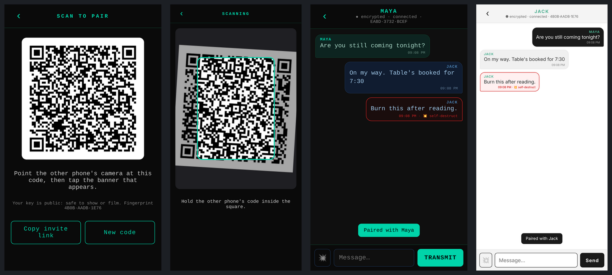

# 📱 SecureChat Mobile
### *The pocket edition. Same prop, same themes, now in the actor's hand.*

> *She holds her phone up. He holds his. A square of black and white passes between them like a secret handshake, the screen blinks, and two strangers are suddenly the only two people in the world who can read each other.*
>
> *On camera, that is a scene. Off camera, it is real encryption.*



---

## 🎬 What it is

The phone branch of [SecureChat](../README.md): a **real, working, end-to-end encrypted messenger** that runs on an **iPhone and an Android** side by side, built so productions have a chat app that looks authentic because it *is*.

- **No App Store, no install file.** It's a web app. Open the link, tap **Add to Home Screen**, and it sits on the phone with its own icon, full screen, like any other app.
- **Keys are made on the phone** on first open and never leave it.
- **Pair with a camera.** One phone shows a QR code; the other points its **ordinary Camera app** at it, taps the banner, and both phones are paired in a single scan. There's an in-app scanner too.
- **The three desktop looks**, matched for continuity: **Dark Teal**, **Amber Terminal** and **Clean Light**. Each phone picks its own, so the spy can have the spy's phone and the civilian the civilian's.
- **Self-destruct messages** glow red, then burn away five seconds after they appear, leaving *— message destroyed —*.
- **Works offline-first.** The app opens with no signal; messages wait and send when it's back; a phone that was off catches up when it reopens.
- **Fingerprints** (e.g. `4B0B·AADB·1E76`) on both screens, for the "check they match" beat.

## 🔐 How the secrets stay secret

Messages are sealed with **NaCl Box** (X25519 + XSalsa20-Poly1305), the very same encryption and the very same message format as the desktop app. The test suite proves it: a message sealed on the phone is opened by the desktop app's own library, and the other way round.

Two phones on mobile data can't reach each other directly, so a small **relay** sits in the middle, like a post office passing sealed envelopes. It never has the keys, so it can't read a word: all it sees is which room an envelope is for, its size and when it arrived. It keeps a short backlog (a week, 200 envelopes per room) so an offline phone can catch up.

**Pairing, step by step:**
1. Jack taps **Show my code**. The QR holds his name, his **public** key and a fresh random room for the two of them.
2. Maya scans it. Her phone saves Jack, joins the room and says hello with *her* public key.
3. Jack's phone asks **"Pair with Maya?"**, showing her fingerprint. He taps **Pair**.

The QR only contains public information, so it's safe to show, film or post. If it is filmed, the confirm step means nobody gets paired without the person holding the phone agreeing.

## 🌍 Live

| Where | Address |
|---|---|
| Netlify | **https://securechat-mobile.netlify.app** |
| GitHub Pages (mirror) | **https://lolo737.github.io/securechat/** |

Both serve the same app. Each address is its own app as far as a phone is concerned (its own keys and contacts), so pick one per production and stick with it. Chat needs a relay: see Option B below.

## 🚀 Running it

You need two things online: **the app** (a folder of static files) and **the relay**. Phones insist on **https** for the camera and for Add to Home Screen.

### Option A: one laptop, on set (quickest)

```bash
npm install
npm start            # app + relay on http://localhost:8787
```

Then give it an https address the phones can reach, for example with [Tailscale Funnel](https://tailscale.com/kb/1223/funnel) (`tailscale funnel 8787`) or `npx localtunnel --port 8787`. Open that address on both phones. The laptop *is* the relay.

### Option B: always on, free

- **App:** deploy the `mobile/` folder to Netlify or GitHub Pages (both free, both https).
- **Relay:** deploy `relay/cloudflare/` to Cloudflare Workers' free tier:
  ```bash
  cd relay/cloudflare
  npx wrangler deploy
  ```
- Put the Worker's address in `mobile/js/config.js`:
  ```js
  self.SC_CONFIG = { relayUrl: "wss://securechat-relay.<you>.workers.dev/ws" };
  ```

Any phone can also point at a different relay in **Settings**.

### On each phone

1. Open the link in **Safari** (iPhone) or **Chrome** (Android).
2. **Share → Add to Home Screen** (iPhone) or **⋮ → Add to Home screen** (Android).
3. Open it from the new icon, pick a name and a look, and tap **Create my keys**.
4. One phone: **Show my code**. The other: point the Camera at it and tap the banner, or use **Scan a code**.

> **iPhone note:** once SecureChat is on the home screen, pair using its own **Scan a code**. iOS keeps home-screen apps' data separate from Safari, so a link opened from the Camera app lands in Safari rather than the installed app. (Scanning with the Camera app is perfect for the *first* open, before installing.) Android shares the data either way.

## 🧪 Tests

```bash
npm test             # keys, invites, sealing, desktop interop, relay
npm run test:phones  # the whole story on an emulated iPhone and Android (needs Playwright)
```

- **9 unit tests:** sealing and opening, tamper and wrong-key rejection, invite links, forged senders, fingerprints, **phone ↔ desktop interop** in both directions against real PyNaCl, and the relay (delivery, catch-up, room isolation, junk and oversized messages, path traversal).
- **The two-phone run:** Jack's QR decodes, Maya opens it and sets up, Jack confirms, messages go both ways, a self-destruct message burns, and Maya catches up after closing the app, with zero errors on either phone. The in-app camera scanner was also tested with a camera feed of a tilted QR code.

**Tested here:** the Node relay, end to end. The **Cloudflare relay** follows the same protocol but couldn't be deployed from here, so give it a first run yourself before a shoot.

## 🗺️ Roadmap

- Phone ↔ **desktop** chat (the encryption already matches; the desktop needs to learn the relay's room protocol)
- Scheduled messages, as on desktop, for plot beats that land on cue
- Group rooms for ensemble scenes
- Custom contact photos and background images for set dressing

## 🗂️ Layout

```
mobile/
├── index.html · css/app.css · js/app.js   the app
├── js/core.js        keys, invites, sealing (tested)
├── js/config.js      where the relay lives
├── sw.js · manifest.webmanifest · icons/  installable, works offline
├── vendor/           TweetNaCl (public domain), jsQR (Apache-2.0), qrcode-generator (MIT)
└── test/             unit tests and the two-phone run
relay/
├── server.js         app + relay in one, for a laptop or VPS
└── cloudflare/       the same relay for Cloudflare Workers
```

*Licensed the same way as SecureChat. See the main [README](../README.md#licence).*
